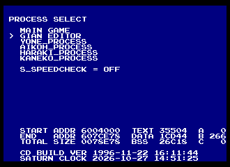
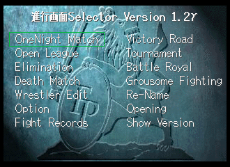
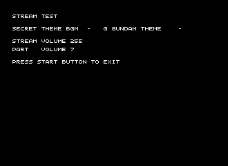
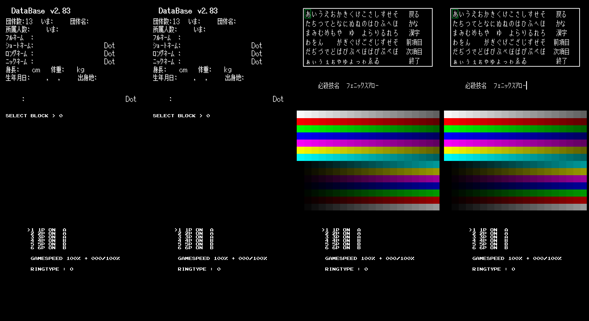
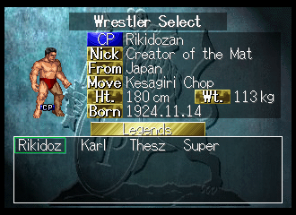
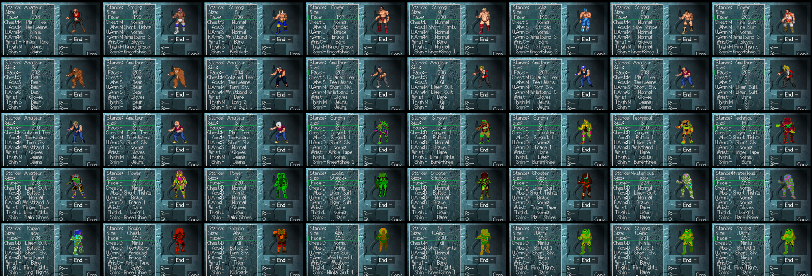
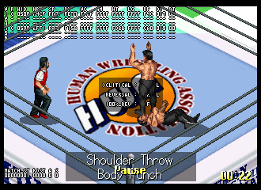
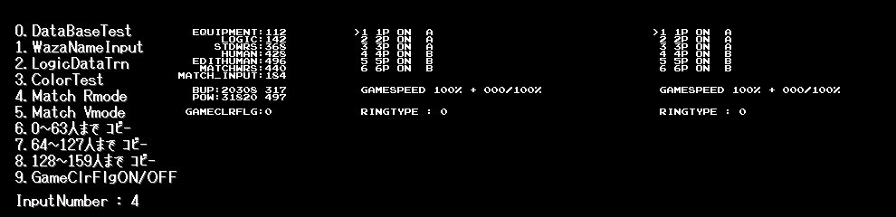

# Hidden content

Unlockables, debug features, button codes, cut and unused content. Every find says how sure it
is:

- *verified in game* - seen in an emulator (with the date, and the build or code used to get there)
- *from the code* - read in the disassembly, not seen running
- *from the data* - in the game's files or tables, whether or not the code uses it
- *from a guide* / *from fans* - a published source, not yet matched with the code

Addresses are Saturn RAM: `1ST.BIN` loads at 0x06004000; `2ND.BIN` (the game) and `3RD.BIN` (the
Gian editor) at 0x06080000; save data lives in low work RAM (0x00200000-). Optional patches that
switch some of this on are in [PATCHES.md](PATCHES.md). "Seen headless" below means seen in a
headless Beetle Saturn emulator, 2026-10-27.

**Prior art (2026-10-27).** The 32bits "Expansion Hack" write-up (2024-05-09,
<https://32bits.substack.com/p/expansion-hack-fire-prowrestling>) found the debug menu and the
extra Edit characters, with an xdelta patch on SegaXtreme (for the (1M) dump). Japanese trick
lists describe the Victory Road unlocks. Almar's Guides and ConsoleDatabase list Action Replay
health codes only (each player's health block: 7 words from 0x060676F6, players 0x1B8 apart). The
Cutting Room Floor, GameFAQs and Sega Retro could not be checked (they refuse automated access);
Data Crystal has no page. Nothing published lists title-screen codes or name-entry passwords - and
the code has none (below).

## Contents
- [Process Select (debug menu)](#process-select-debug-menu)
- [Haraki: developer mode selector](#haraki-developer-mode-selector)
- [Yone: pad test, backup utility, sound test with a secret G Gundam theme](#yone-pad-test-backup-utility-sound-test)
- [Aikoh: database and test tools](#aikoh-database-and-test-tools)
- [Kaneko: ending selector](#kaneko-ending-selector)
- [Hidden roster wrestlers and the game-clear flag](#hidden-roster-wrestlers-and-the-game-clear-flag)
- [Hidden Wrestler Edit presets](#hidden-wrestler-edit-presets)
- [In-match debug monitor](#in-match-debug-monitor)
- [Debug match setup screen](#debug-match-setup-screen)
- [Dummy match result screen](#dummy-match-result-screen)
- [Cut moves](#cut-moves)
- [Unused files and pictures](#unused-files-and-pictures)
- [Small things](#small-things)
- [Searched and not found](#searched-and-not-found)
- [How to see it yourself](#how-to-see-it-yourself)

## Process Select (debug menu)
*Seen headless* (`build.py --unlocks debug-menu`). At boot `1ST.BIN` stores mode 0 in 0x0605629C
(0x06024E28), loads `2ND.BIN` and runs it; 2ND's entry jumps by that mode (0 game, 2 Yone,
3 Aikoh, 4 Haraki, 5 Kaneko; 1 = the Gian editor, `3RD.BIN`). When 2ND returns, 1ST shows
**PROCESS SELECT** (code 0x06024E88): MAIN GAME, GIAN EDITOR, YONE_PROCESS, AIKOH_PROCESS,
HARAKI_PROCESS, KANEKO_PROCESS (named after staff in the credits), an S_SPEEDCHECK toggle (L/R:
a CPU-time colour meter), the memory map and "CD BUILD VER 1996-11-22 16:11:44". The normal game
never returns, so the menu is unreachable; storing 1 instead of 0 shows it at boot.

## Haraki: developer mode selector
*Seen headless.* "進行画面Selector Version 1.2γ": OneNight Match, Victory Road, Open League,
Tournament, Elimination, Battle Royal, Death Match, Grousome Fighting, Wrestler Edit, Re-Name,
Option, Opening, **Fight Records**, Show Version. Fight Records does nothing - a cut mode (2ND jump
table 0x060909F8, case 12). Show Version runs the game from the logo. Haraki first shows the normal
Mode Select; the selector appears after Mode Select exits (poke 0x0605FD31 = 1 in Haraki's Mode
Select, or patch 2ND 0x0609085E `410B` -> `0009`). Two status labels, "Now Making." / "Not
Making.", are never shown.

## Yone: pad test, backup utility, sound test
*Seen headless.* A peripheral check (pad and device dump), "SYSTEM DEVICE UTILITY 7/30" (backup
check, copy and format, including the Saturn floppy drive), and a stream sound test of the 38
BGM. **BGM 37, "SECRET THEME BGM - G GUNDAM THEME"** (FPS.STR streams 40-41: a 4 s intro and a
53 s loop) is played by nothing in the normal game - every theme range there stops at 34 or 36.
In Yone's stream test, poke 0x060CB7EC = 0x25 and press C. The "(Unlocked)" patches also let Wrestler
Edit's Theme field reach it (2ND 0x060BF900 `0022` -> `0025`; *seen headless*: the field shows
"G Gundam Theme").

## Aikoh: database and test tools
*Seen headless.* Ten numbered entries (D-pad picks, A or C runs, START exits): DataBase v2.83
(wrestler record viewer), move-name keyboard, LogicDataTrn (dumps edit wrestlers' CPU logic),
colour test, Match R mode / Match V mode (matches through the debug setup screen below), copy
roster wrestlers 0-63 / 64-127 / 128-159 into the Edit slots and save, and **GameClrFlg ON/OFF**
(the game-clear flag below). Holding Y+Z+L and pressing START calls an emptied function - a removed
developer entry.

## Kaneko: ending selector
*Seen headless.* HEAVY ENDING, JUNIOR ENDING, STAFF ROLL, STAFF ROLL TEST (UP/DOWN, A) - the two
Victory Road endings and the credits.

## Hidden roster wrestlers and the game-clear flag
*From the code; unlocks seen headless.* 24 roster wrestlers (roster order 136-159 at 0x0603E5C8)
are listed only when the save's game-clear flag is set (0x00212B49, RAM copy 0x060682E8) or once
each has been beaten (bits 0x00212B4A-4C, set after a won match). The flag is set by 1ST
0x0601AFE0 when both Victory Road singles titles (heavy, junior) have champions. With it:
- the 24 wrestlers appear, including a 14th promotion, **Legends** (the game's HIDE: Rikidozan,
  Karl Gotch, Lou Thesz, Super Strong Machine), and extra wrestlers in other promotions;
- Options' Music Test runs 2-36 instead of 5-34;
- Wrestler Edit gives 200 points instead of 180 (255 with all five title records; the
  "(Unlocked)" patches always give 255);
- One Night Match lets you assign more players than connected pads.
The "(Unlocked)" patches list the 24 from the start (with the rest of the clear's unlocks) (*seen headless*: 14 promotion pages
instead of 13). This matches the Japanese trick lists (*from fans*), which add that clearing
promotions in Victory Road unlocks their hidden members.

## Hidden Wrestler Edit presets
*Seen headless; from the code and data.* Wrestler Edit's Appearance "Face" row is the base
character: 0-159 roster, 160+ presets copied by 2ND 0x060B26A4 from tables that hold exactly
presets 160-212. The list stops at 204 (count byte 0x060C4E0A). **204-208** are five complete
presets of their own (headband, long blond hair, very spiky hair, cap, short dark hair - the
32bits write-up reads them as Akira, Jacky and Kyo/Terry lookalikes), **209-212** reuse the data of
206/207/208/208. Past 212 the routine reads other tables as colours: the "broken" extras earlier
patches showed (and GCD.BIN has heads up to 215 - a mecha head, a white bob, a striped helmet -
with no preset data). The "(Unlocked)" patches extend the list to 212.

## In-match debug monitor
*Seen headless* (`build.py --unlocks debug-monitor`). 1ST 0x06016398-0x06016EC3 is never called:
pause a match, then R steps through eight pages of ASCII tables over the match (positions, HP and
damage, current move and animation frame, pad input) and a CRITICAL / REVERSAL box; L picks the
wrestler in focus. Page 1+ also turns on a CPU-time colour meter still compiled into the match loop.

## Debug match setup screen
*Seen headless.* 1ST 0x06016EC4, before every match but skipped by the normal game (it only runs
for Aikoh's Match modes): 1P-6P ON/OFF, team A-F, GAMESPEED, RINGTYPE. X picks the controller, Y
on/off, Z the team, L/R the game speed, A/C the ring type. Patch to show it before every match:
1ST 0x06016F98 `8801` -> `8803` (*from the code*; in one test the match stayed on NOW LOADING
afterwards).

## Dummy match result screen
*From the code.* "試合（ダミー）" (2ND 0x06090F74): every button picks a result - A/B/C/X/Y the
blue corner by pin/submission/KO/ring-out/DQ, Z a draw, Up a double ring-out, the rest a red-corner
win. It needs match result byte 0x06068281 = 2, which the match never writes. Untested patch: 1ST
0x0600A780 `E101` -> `E102` (skipping a skippable CPU match opens it).

## Cut moves
*From the data.* Named moves no wrestler or Edit list uses, each with an empty entry in the motion
file GSS.GSF: 256-258 Pendulum Uppercut (振り子アッパー), 259 Shoryu Reppa (昇龍裂破 - Ken's super
from Street Fighter), 260-261 Go-Go (ゴーゴー), 715 Low Kneel Kick (低空ニールキック), 2090 Double
Avalanche (合体アバランシュホールド, a fifth tag combo; Edit's range stops at 2089). Translated anyway.

## Unused files and pictures
*From the code and data.*
- **GSR.GSF (17 MB) and GSB.GSF (2.1 MB)** are never opened (every file open goes through
  1ST 0x06025238; neither name is in the code). GSB is a fixed-slot working copy of GSS.GSF (the
  motion file); GSR holds only copies of GSS entries - editor leftovers. The Gian editor (3RD.BIN)
  still names development files: kihon / waza / ootani .gsf, SKILL_FILE, FORM__FILE, FPX.F96.
- **FPS.SBL resources never loaded:** 62/63 an unused championship belt picture and its palette;
  33 the 制覇 banner's own palette (the game draws it with 優勝's palette instead); 84 a byte copy
  of the sound driver SDDRVS.TSK; 83 tables and a fragment of 68000 code (tool memory slack); 81 a
  4-colour palette; 82 a small VDP2 map.
- **Mode name table** 2ND 0x060BE60C (half-width ワンナイトマッチ ... ビクトリー・ロード, 10 entries,
  some empty) - nothing points to it.

## Small things
- A one-frame boot splash "DEBUG MODE / SS RAY-SYSTEM VER 0.15 ... (C) 1996 HUMAN CORP" (1ST
  0x06004D48; patch 1ST 0x06004D56 `E900` -> `E97F` holds it). *From the code.*
- X+Y+Z while paused hides the "Pause" label (*seen headless*) - handy for screenshots.
- The Gian editor (3RD.BIN, "GIAN EDITOR" in Process Select) is a mouse-driven motion/form
  editor; with a pad, the D-pad moves the cursor and C / B / A+START are the buttons.
- Soft reset is the standard A+B+C+START.

## Searched and not found
- Button-sequence cheat codes: no table of pad sequences anywhere; the only multi-button checks
  are the ones above (pads: 0x0605E540 pad 1, +0 held, +2 pressed, +4 repeat).
- Name-entry passwords: nothing compares an entered name with fixed text (name entry 2ND
  0x060ADEC0).
- Flags only ever cleared and never set: none.
- Unreachable Mode Select entries: none (11 modes, 12 with Title Match).
- Any other FPS.SBL load or file name in the code; motion data for the cut moves; readable text in
  GSR/GSB beyond GSS.
- Referees (4, all used) and ring backdrops (4 ring types x 13 + octagon and death match, all used).
- Not checked: Options, Victory Road and Wrestler Edit sub-menus entry by entry; FPS.SND's table;
  the disc's audio track 2 (about 7 s).

## How to see it yourself
| Find | How |
|---|---|
| Process Select, Haraki/Yone/Aikoh/Kaneko | `python3 build.py --unlocks debug-menu` (developer build) - the game boots into Process Select; HARAKI_PROCESS leads to Mode Select |
| Hidden Edit presets 204-212 | the same; Wrestler Edit -> Appearance -> Face, RIGHT past 203 |
| Hidden roster wrestlers | win both Victory Road singles titles, or beat them; or the "(Unlocked)" patches; or Aikoh's GameClrFlg |
| G Gundam theme | "(Unlocked)" patches -> Wrestler Edit -> Skill Edit -> Theme (37), or YONE_PROCESS -> stream test (RAM 0x060CB7EC = 0x25, C) |
| Match monitor | `python3 build.py --unlocks debug-monitor` (developer build only); pause, R |
| Debug match setup | `--unlocks debug-menu` -> AIKOH_PROCESS entry 4 or 5 |
