# Screenshots

Fire Pro Wrestling S - 6Men Scramble with the English patch (real names), at the Saturn's
native 320x224, taken in an emulator.

## Mode Select

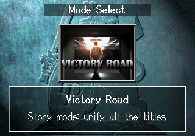

Every mode name and description in English, including the new "Story mode" line for Victory Road.

## Wrestler Select

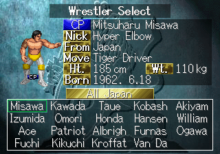

Profiles with real names (or parody names in the other patch), nicknames, hometowns and finishers; the field labels were redrawn as English pictures.

## Victory Road

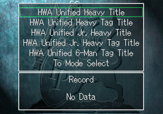

The five HWA unified titles you can fight for.

## Victory Road opening

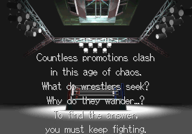

The opening narration, rewritten to fit the game's line and sprite limits.

## Pre-match interview

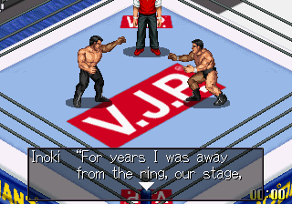

About 1,600 lines of Victory Road interviews, each fitted to the in-ring box.

## Pre-match interview

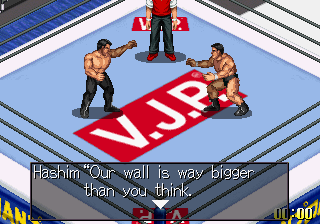

Each wrestler keeps his own voice: cocky, gruff, polite or comic.

## In a match

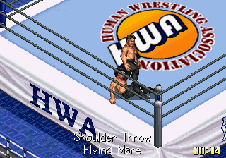

About 600 move names, shown as they happen.

## Match result

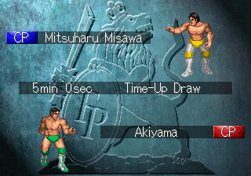

Times, finishes and results.

## Title Match

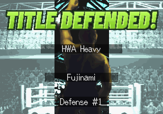

The result banners are redrawn in the original style (TITLE DEFENDED!, TITLE WON!, CHAMPION!, VICTORY!, CONQUERED!).

## Open League

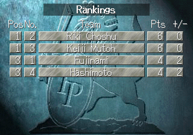

League tables and rankings.

## Wrestler Edit: moves

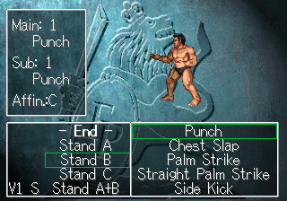

Every move list and button command in Wrestler Edit.

## Wrestler Edit: skills

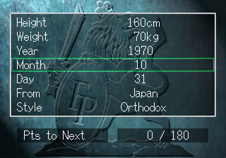

Profiles, stats and options for your own wrestlers.

## Options

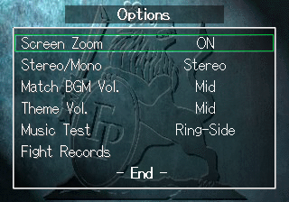

Settings, the Music Test and Fight Records.

## Heavyweight ending

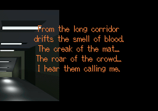

The ending narration, with the game's fixed-width ending lettering made proportional so English reads evenly.

## Heavyweight ending

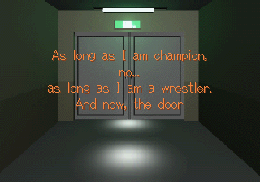

"As long as I am champion, / no... / as long as I am a wrestler."

## Junior heavyweight ending

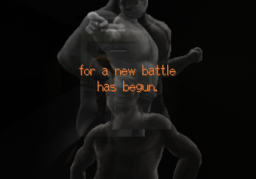

The second ending, translated in full.

## Junior heavyweight ending

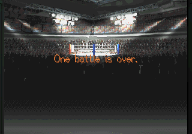

"One battle is over."

## (Unlocked) patches

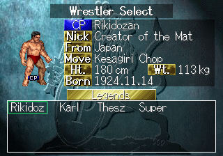

Everything a full game clear unlocks, from the start: here the hidden Legends promotion.
